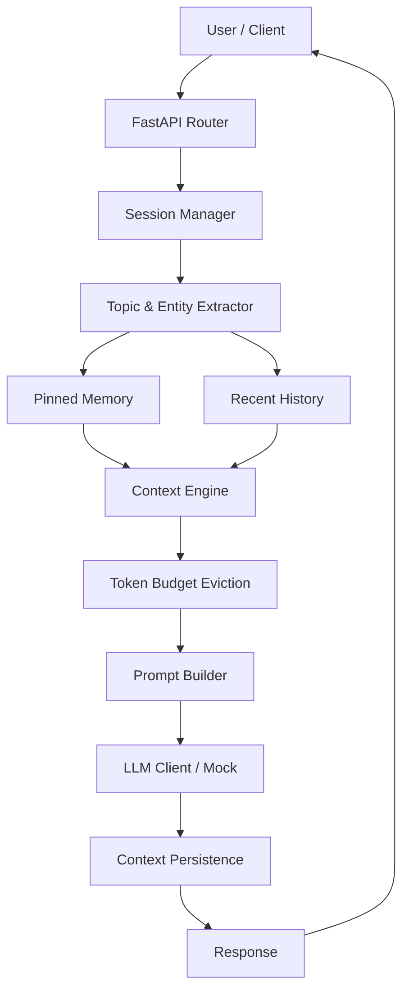

# Context-Aware IT Helpdesk Agent with Token Budgets and Pinned Memory

A production-ready university IT helpdesk AI agent engineered with manual, deterministic **Context Engineering**: pinned entity memory, rolling recent conversation history, FIFO token-budget eviction, active topic tracking, prompt construction, state persistence, error rollback, and automated multi-turn evaluation.

---

## Table of Contents

1. [Project Overview](#1-project-overview)
2. [Problem Statement](#2-problem-statement)
3. [Why Context Engineering is Needed](#3-why-context-engineering-is-needed)
4. [Architecture Diagram](#4-architecture-diagram)
5. [Technology Stack](#5-technology-stack)
6. [Project Structure](#6-project-structure)
7. [Setup Instructions](#7-setup-instructions)
8. [Environment Variables](#8-environment-variables)
9. [Running Locally](#9-running-locally)
10. [Running with Docker](#10-running-with-docker)
11. [API Documentation](#11-api-documentation)
12. [Example API Requests and Responses](#12-example-api-requests-and-responses)
13. [Explanation of Pinned Memory](#13-explanation-of-pinned-memory)
14. [Explanation of Token Eviction](#14-explanation-of-token-eviction)
15. [Explanation of Active Topic Tracking](#15-explanation-of-active-topic-tracking)
16. [Error Handling and Rollback](#16-error-handling-and-rollback)
17. [Testing](#17-testing)
18. [Five-Turn Evaluation](#18-five-turn-evaluation)
19. [Design Decisions](#19-design-decisions)
20. [Known Limitations](#20-known-limitations)
21. [Future Improvements](#21-future-improvements)

---

## 1. Project Overview

University IT helpdesks routinely encounter users who submit inquiries across multiple conversational turns: introducing a ticket number, digressing into immediate troubleshooting questions (such as campus WiFi or printer setups), and later circling back to their original ticket.

Standard LLM chat wrappers either send the entire chat history (which exhausts token budgets and inflates API costs) or employ naive truncation that indiscriminately drops critical facts like ticket identifiers.

This project implements a **Context-Aware IT Helpdesk Agent** that guarantees:
- **Critical entities (e.g., ticket ID `IT-XXXX`) survive indefinitely** via pinned memory.
- **Recent conversational messages are strictly token-budgeted** using accurate `tiktoken` counting and deterministic FIFO eviction.
- **The conversational topic is tracked and maintained** across dialogue shifts.
- **State consistency is guarded** by pre-execution snapshots and post-failure rollbacks.
- **Every turn is persisted to human-readable JSON files** for observability and auditability.
- **Zero reliance on opaque memory frameworks** (no LangChain, no high-level memory abstractions).

---

## 2. Problem Statement

LLMs operate over finite context windows, and commercial LLM APIs charge per token. In multi-turn conversations:
1. **Unbounded History:** As turns accumulate, prompt size grows linearly or quadratically, degrading performance, raising latency, and rapidly breaching token limits.
2. **Context Amnesia:** If a sliding window or FIFO buffer simply drops the oldest messages, important identification details provided at the beginning (such as ticket IDs, user hardware, or student numbers) are permanently lost.
3. **Hallucination of External State:** When asked about ticket statuses without a live database connection, naive agents invent status reports ("Your ticket IT-9921 is resolved!").

---

## 3. Why Context Engineering is Needed

Context Engineering separates **immutable state / critical facts** from **ephemeral conversational dialogue**:

```
+-------------------------------------------------------------+
|                     Agent Context Object                    |
+-------------------------------------------------------------+
|  Pinned Memory:   { "ticket_id": "IT-8812" }                | <-- Immune to eviction
|  Active Topic:    "wifi_issue"                              | <-- State tracking
|  Recent History:  [ Message 1, Message 2, ... ]             | <-- Subject to token budget
|  Recent Tokens:   64 / Budget (e.g. 100 or 4000)            |
+-------------------------------------------------------------+
```

When an eviction event occurs:
- The oldest message in `recent` is evicted.
- `pinned.ticket_id` remains completely intact.
- The `PromptBuilder` re-injects pinned memory and the current topic into the system prompt on every turn.
- Even if the turn where the user said *"My ticket is IT-8812"* was evicted 20 turns ago, the LLM still knows the ticket ID is `IT-8812`.

---

## 4. Architecture Diagram



### Detailed Pipeline Flow (14-Step Deterministic Order)
1. **Validate Request:** Validate `session_id` and non-empty `message` via Pydantic models.
2. **Load or Create Session:** Lookup `session_id` in in-memory session store; if not cached, attempt warm restart from disk.
3. **Snapshot Context:** Deep-copy context state to allow full rollback if downstream stages fail.
4. **Analyze Message:** Run deterministic extractors on user input.
5. **Extract Ticket ID:** Regex extraction (`\bIT-[0-9]{4}\b`).
6. **Update Pinned Memory:** Store `pinned.ticket_id` (latest mentioned ticket takes priority).
7. **Detect Active Topic:** Rule-based keyword matching against controlled vocabulary (`general`, `ticket_inquiry`, `wifi_issue`, etc.), preserving topic continuity for follow-up questions.
8. **Add User Message:** Append to `recent` array.
9. **Count Tokens:** Calculate tokens using `tiktoken` (`cl100k_base`).
10. **Apply Token Budget Eviction:** FIFO-evict oldest messages until total recent tokens <= `TOKEN_BUDGET_LIMIT`.
11. **Build Prompt:** Inject system persona, active topic, pinned facts, and surviving recent messages into OpenAI chat schema.
12. **Call LLM:** Dispatch prompt to configured provider (`openai` or deterministic `mock`).
13. **Success Path:**
    - Append assistant message to `recent`.
    - Apply token budget eviction again.
    - Persist context to `logs/context_{session_id}.json`.
    - Return `ChatResponse(response=..., active_topic=...)`.
14. **Failure Path:**
    - Restore session state from snapshot.
    - Abort disk persistence.
    - Log error server-side and return HTTP 500 without leaking secrets or internals.

---

## 5. Technology Stack

- **Language:** Python 3.12+ (compatible with Python 3.10+)
- **API Framework:** FastAPI 0.115.6 + Uvicorn 0.34.0
- **Tokenization:** `tiktoken` 0.8.0 (`cl100k_base` encoding)
- **Data Validation:** Pydantic 2.10.4
- **LLM Integration:** OpenAI Python SDK 1.58.1 (with deterministic Mock LLM provider)
- **Testing:** `pytest` 8.3.4, `pytest-asyncio` 0.25.0, `httpx` 0.28.1
- **Configuration:** `python-dotenv` 1.0.1
- **Containerization:** Docker & Docker Compose

---

## 6. Project Structure

```
context-aware-helpdesk/
|
+-- src/
|   +-- __init__.py           # Source package marker
|   +-- config.py             # Centralized typed environment configuration
|   +-- models.py             # Pydantic models (domain models & API schemas)
|   +-- extractor.py          # Deterministic ticket & topic extraction
|   +-- context_engine.py     # Token counting, FIFO eviction, session store, persistence
|   +-- prompt_builder.py     # Persona, topic, pinned fact, and history prompt formatting
|   +-- llm_client.py         # Abstract LLM client, OpenAI provider, and Mock provider
|   +-- api.py                # FastAPI endpoints, pipeline orchestration, error rollback
|
+-- tests/
|   +-- __init__.py           # Tests package marker
|   +-- test_extractor.py     # Ticket extraction and topic detection unit tests
|   +-- test_context_engine.py# Session store, token counting, persistence, rollback tests
|   +-- test_token_eviction.py# FIFO eviction, budget enforcement, pinned memory survival
|   +-- test_error_rollback.py# LLM failure rollbacks and security sanitization tests
|   +-- test_api.py           # HTTP endpoints, session isolation, validation tests
|
+-- logs/
|   +-- .gitkeep              # Keeps directory in VCS; context_*.json ignored by git
|
+-- eval_5_turns.py           # Standalone automated 5-turn evaluation script
+-- Dockerfile                # Multi-stage production container build
+-- docker-compose.yml        # Docker compose service definition with mounted volume
+-- .dockerignore             # Excludes caches, git, and local logs from build context
+-- requirements.txt          # Pinned production and test dependencies
+-- pyproject.toml            # Pytest configuration
+-- .env.example              # Environment variables template (no secrets)
+-- .gitignore                # Git ignore patterns
+-- README.md                 # Complete system documentation
+-- VERIFY.md                 # Step-by-step verification checklist and curl commands
```

---

## 7. Setup Instructions

### Prerequisites
- Python 3.10+ (Python 3.12 recommended)
- `pip`

### Step 1: Clone or Navigate to Repository
```bash
cd "Context-Aware IT Helpdesk Agent"
```

### Step 2: Create and Activate Virtual Environment (Optional but Recommended)
```bash
# Windows
python -m venv venv
venv\Scripts\activate

# Linux / macOS
python3 -m venv venv
source venv/bin/activate
```

### Step 3: Install Dependencies
```bash
pip install -r requirements.txt
```

### Step 4: Configure Environment
Copy `.env.example` to `.env`:
```bash
# Windows
copy .env.example .env

# Linux / macOS
cp .env.example .env
```

---

## 8. Environment Variables

All variables are loaded via `src/config.py`:

| Variable | Type | Default | Description |
|---|---|---|---|
| `OPENAI_API_KEY` | string | `""` | OpenAI API key. Required only if `LLM_PROVIDER=openai`. |
| `OPENAI_MODEL` | string | `gpt-4o-mini` | OpenAI model identifier (e.g., `gpt-4o`, `gpt-4o-mini`). |
| `TOKEN_BUDGET_LIMIT` | integer | `4000` | Maximum token capacity for recent conversation history. |
| `LLM_PROVIDER` | string | `mock` | LLM backend: `mock` (deterministic local mode) or `openai`. |
| `LOGS_DIR` | string | `logs` | Directory path for saving session context JSON files. |

> **Security Note:** The application runs out-of-the-box in `LLM_PROVIDER=mock` mode without any API key. Secrets are never logged or returned in API error responses.

---

## 9. Running Locally

Start the application with Uvicorn:

```bash
uvicorn src.api:app --host 0.0.0.0 --port 8000 --reload
```

The server will be available at:
- **Base URL:** `http://localhost:8000`
- **Health Check:** `http://localhost:8000/health`
- **Interactive OpenAPI Docs:** `http://localhost:8000/docs`

---

## 10. Running with Docker

### Using Docker Compose
Build and run the container:
```bash
docker compose up --build
```
Or in detached mode:
```bash
docker compose up -d
```

### Using Standalone Docker
Build image:
```bash
docker build -t it-helpdesk-agent .
```

Run container with logs volume mounted:
```bash
docker run -p 8000:8000 -v ./logs:/app/logs --env LLM_PROVIDER=mock it-helpdesk-agent
```

Check health:
```bash
curl http://localhost:8000/health
```

Stop container:
```bash
docker compose down
```

---

## 11. API Documentation

### 1. `GET /health`
Verifies service availability.
- **Status:** `200 OK`
- **Response Schema:**
  ```json
  {
    "status": "ok"
  }
  ```

### 2. `POST /v1/chat`
Processes a message within a conversational session.
- **Request Headers:** `Content-Type: application/json`
- **Request Body:**
  ```json
  {
    "session_id": "string (required, min_length 1)",
    "message": "string (required, min_length 1)"
  }
  ```
- **Response Schema (`200 OK`):**
  ```json
  {
    "response": "string",
    "active_topic": "string"
  }
  ```
- **Error Responses:**
  - `422 Unprocessable Entity`: Missing or empty `session_id` or `message`.
  - `500 Internal Server Error`: LLM failure (session state is safely rolled back).

### 3. `GET /v1/context/{session_id}`
Returns the complete context state object for observability.
- **Parameters:** `session_id` (path string)
- **Response Schema (`200 OK`):**
  ```json
  {
    "session_id": "test_session",
    "active_topic": "wifi_issue",
    "pinned": {
      "ticket_id": "IT-9921"
    },
    "recent": [
      {
        "role": "user",
        "content": "My WiFi is not working",
        "tokens": 8
      },
      {
        "role": "assistant",
        "content": "Let's troubleshoot your WiFi connection...",
        "tokens": 12
      }
    ],
    "total_recent_tokens": 20
  }
  ```
- **Error Responses:**
  - `404 Not Found`: Session ID does not exist in memory or disk.

---

## 12. Example API Requests and Responses

### Example 1: Submit Ticket ID
```bash
curl -X POST http://localhost:8000/v1/chat \
  -H "Content-Type: application/json" \
  -d '{
    "session_id": "user123",
    "message": "My ticket is IT-9921"
  }'
```
**Response:**
```json
{
  "response": "I've noted your ticket ID IT-9921. I don't have access to the university's ticketing system to look up its details, but I'll keep this ticket ID associated with our conversation. How can I help you today?",
  "active_topic": "ticket_inquiry"
}
```

### Example 2: Inspect Context
```bash
curl http://localhost:8000/v1/context/user123
```
**Response:**
```json
{
  "session_id": "user123",
  "active_topic": "ticket_inquiry",
  "pinned": {
    "ticket_id": "IT-9921"
  },
  "recent": [
    {
      "role": "user",
      "content": "My ticket is IT-9921",
      "tokens": 8
    },
    {
      "role": "assistant",
      "content": "I've noted your ticket ID IT-9921...",
      "tokens": 44
    }
  ],
  "total_recent_tokens": 52
}
```

### Example 3: Topic Switch to WiFi
```bash
curl -X POST http://localhost:8000/v1/chat \
  -H "Content-Type: application/json" \
  -d '{
    "session_id": "user123",
    "message": "Actually, my WiFi in the library dropped. I am using a Mac."
  }'
```
**Response:**
```json
{
  "response": "Let's troubleshoot your WiFi connection on Mac. Here are the steps:\n\n1. Click the WiFi icon in the menu bar and toggle WiFi off, then back on...\n",
  "active_topic": "wifi_issue"
}
```

---

## 13. Explanation of Pinned Memory

Pinned memory stores essential domain facts that must never be discarded by token eviction.

### Implementation Details:
- **Entity Model:** `PinnedMemory(ticket_id: Optional[str])`.
- **Extraction:** Deterministic regular expression:
  ```python
  _TICKET_PATTERN = re.compile(r"\bIT-(\d{4})\b")
  ```
- **Policy on Multiple Tickets:** If a user specifies multiple ticket numbers (e.g., *"My old ticket was IT-1111, but my new ticket is IT-2222"*), the extractor returns the **latest ticket mentioned** (`IT-2222`), which updates `pinned.ticket_id`.
- **Immunity:** During eviction, the algorithm operates **strictly** on the `recent` array. `pinned` is stored as a top-level property and is never truncated or removed.
- **Prompt Injection:** On every turn, `PromptBuilder` formats pinned facts:
  ```
  Known pinned facts:
  Ticket ID: IT-8812
  ```
  This is injected into the LLM system prompt regardless of how many recent messages were evicted.

---

## 14. Explanation of Token Eviction

Recent conversational turns are tracked under a strict token budget.

### Algorithm (Deterministic FIFO):
1. User message arrives and is tokenized via `tiktoken.get_encoding("cl100k_base")`.
2. The message is appended to `recent`, and its tokens added to `total_recent_tokens`.
3. If `total_recent_tokens > TOKEN_BUDGET_LIMIT`:
   - Evict `recent[0]` (the oldest message).
   - Subtract `evicted.tokens` from `total_recent_tokens`.
   - Repeat until `total_recent_tokens <= TOKEN_BUDGET_LIMIT`.
4. When the assistant responds, its tokens are added, and the budget check is repeated.

### Concrete Example:
- Budget: `50 tokens`.
- Message A (40 tokens) added -> Total = 40.
- Message B (40 tokens) added -> Total = 80 > 50.
- Message A is evicted.
- Surviving: `[Message B]`, Total = 40 tokens.

---

## 15. Explanation of Active Topic Tracking

The system tracks the user's active focus across a controlled vocabulary:
- `general`
- `ticket_inquiry`
- `wifi_issue`
- `printing_issue`
- `network_issue`
- `password_issue`
- `software_issue`

### Topic Continuity Rule:
In natural dialogue, follow-up messages often omit topic keywords (e.g., *"Can you give me more troubleshooting steps?"*).
- When a user query produces a specific topic match, `active_topic` updates immediately.
- When a follow-up query yields `"general"` (no explicit new topic detected) and the context already has an active specific topic (such as `wifi_issue`), the context engine **maintains the active topic**.
- When the user explicitly switches topics (e.g., *"Let's go back to my ticket"*), the topic updates to `ticket_inquiry`.

---

## 16. Error Handling and Rollback

To ensure state consistency, the `/v1/chat` pipeline creates an in-memory snapshot before processing:

```python
snapshot = snapshot_context(ctx)
```

If an error occurs (such as an LLM provider timeout, rate limit, or invalid response):
1. `restore_context(snapshot)` reverts the in-memory context to its exact pre-request state.
2. The failed user message is **not** appended.
3. Disk persistence is aborted.
4. An HTTP 500 response is returned with a sanitized message (`"An internal error occurred."`).
5. Internal stack traces and API keys are logged server-side only.

---

## 17. Testing

A suite of 103 unit and integration tests covers the system.

### Test Structure:
- `tests/test_extractor.py`: Ticket regex matches, invalid formats, boundary checks, multiple tickets, topic keyword rules.
- `tests/test_context_engine.py`: Token counting (`tiktoken`), FIFO eviction, session management, session isolation, snapshot/rollback, JSON persistence.
- `tests/test_token_eviction.py`: Detailed FIFO ordering, cascading evictions, pinned memory survival under aggressive eviction.
- `tests/test_error_rollback.py`: LLM failure recovery, empty session recovery, secret leak prevention.
- `tests/test_api.py`: `/health`, `/v1/chat`, `/v1/context/{session_id}`, validation errors (missing fields), session isolation via HTTP, 5-turn multi-turn conversation.

### Running Tests:
```bash
python -m pytest tests/ -v
```

**Result:**
```
============================= 103 passed in 1.91s =============================
```

---

## 18. Five-Turn Evaluation

The standalone script `eval_5_turns.py` proves the central premise of the project: **pinned memory survives token eviction during multi-turn dialogue.**

### Evaluation Execution:
```bash
python eval_5_turns.py
```

### The 5-Turn Sequence:
1. **Turn 1:** `"Hi, I need help."`
   - Verified: `active_topic == "general"`
2. **Turn 2:** `"My ticket is IT-8812."`
   - Verified: `pinned.ticket_id == "IT-8812"`, `active_topic == "ticket_inquiry"`
3. **Turn 3:** `"Actually, before we do that, my WiFi in the library just dropped. I am using a Mac. It says connected without internet. Please give me detailed troubleshooting instructions."`
   - Verified: `active_topic == "wifi_issue"`, `pinned.ticket_id == "IT-8812"`
4. **Turn 4:** `"Can you give me more detailed Mac troubleshooting steps?"`
   - Verified: Topic continuity maintained (`wifi_issue`), `pinned.ticket_id == "IT-8812"`
5. **Turn 5:** `"Okay, I fixed the WiFi. Let's go back to my original ticket. Can you confirm the ticket number I mentioned earlier?"`
   - Verified: Topic switched to `ticket_inquiry`.
   - Verified: `pinned.ticket_id == "IT-8812"`.
   - Verified: Final response explicitly contains `"IT-8812"`.
   - Verified: Token budget forced eviction of Turn 2 from recent history (`"My ticket is IT-8812"` no longer exists in `recent`).
   - Verified: Final context persisted to `logs/context_eval_session_5turn.json`.

### Result Output:
```
==================================================
  5-TURN CONTEXT EVALUATION
==================================================

  [PASS] Health endpoint returns 200
  [PASS] Turn 1: HTTP 200
  [PASS] Turn 1: active_topic == general
  [PASS] Turn 2: HTTP 200
  [PASS] Turn 2: active_topic == ticket_inquiry
  [PASS] Turn 2: pinned ticket == IT-8812
  [PASS] Turn 3: HTTP 200
  [PASS] Turn 3: active_topic == wifi_issue
  [PASS] Turn 3: pinned ticket == IT-8812
  [PASS] Turn 4: HTTP 200
  [PASS] Turn 4: active_topic == wifi_issue
  [PASS] Turn 4: pinned ticket == IT-8812
  [PASS] Turn 5: HTTP 200
  [PASS] Turn 5: pinned ticket == IT-8812
  [PASS] Turn 5: response contains IT-8812
  [PASS] Token eviction occurred (recent_tokens <= budget)
  [PASS] Pinned ticket survived eviction (IT-8812)
  [PASS] Context persisted to disk
  [PASS] Persisted context has correct ticket
  [PASS] Original ticket message evicted from recent (proves eviction)

==================================================
  RESULT: PASS (20/20 checks)
==================================================
```

---

## 19. Design Decisions

1. **Manual Context Engineering over Frameworks:**
   No LangChain, LlamaIndex, or generic memory abstractions are used. The state engine is written from first principles to ensure deterministic, auditable, and debuggable memory management.
2. **Deterministic Pre-LLM Extraction:**
   Entity extraction (`IT-XXXX`) and topic classification use fast, deterministic regular expressions and keyword rules before the prompt is constructed. This eliminates unnecessary LLM latency and cost.
3. **Session Isolation by Design:**
   Sessions map strictly to unique `session_id` keys in memory and separate `context_{session_id}.json` files on disk. State from one session cannot leak into another.
4. **Context Engine Independence:**
   The entire context engine (token counting, eviction, persistence, retrieval, and isolation) functions without an LLM. The LLM only generates conversational responses.
5. **No Hallucinated Ticket Status:**
   The agent persona is explicitly instructed: *"If the user asks about a ticket but only the ticket ID is known, explain that you know the ticket ID from the conversation but do not have access to the university's ticketing system to retrieve its live status."*

---

## 20. Known Limitations

- **Single Active Entity:** Currently pins `ticket_id`. Additional entities (e.g., student ID, building name) can be pinned by expanding `PinnedMemory`.
- **In-Memory Store:** Uses an in-memory dictionary backed by disk JSON files. For horizontally scaled deployments across multiple server instances, a shared Redis or PostgreSQL store would be required.
- **Rule-Based Topic Classifier:** The rule-based classifier handles defined university IT domains, but complex semantic shifts may benefit from an LLM-assisted zero-shot classifier fallback.

---

## 21. Future Improvements

- **PostgreSQL / Redis Session Adapter:** Pluggable distributed backend for multi-instance deployments.
- **Live Ticket System Integration:** REST client to university ITSM (e.g., ServiceNow, Jira Service Management) to query real-time ticket statuses.
- **Semantic Memory / Vector Store:** Hybrid retrieval combining pinned facts with vector embeddings for campus knowledge base articles.
- **Streaming Responses:** WebSocket or Server-Sent Events (SSE) support for token-by-token UI updates.
- **Multi-Entity Pinned Memory:** Support pinning user operating system, campus location, and device MAC address.
